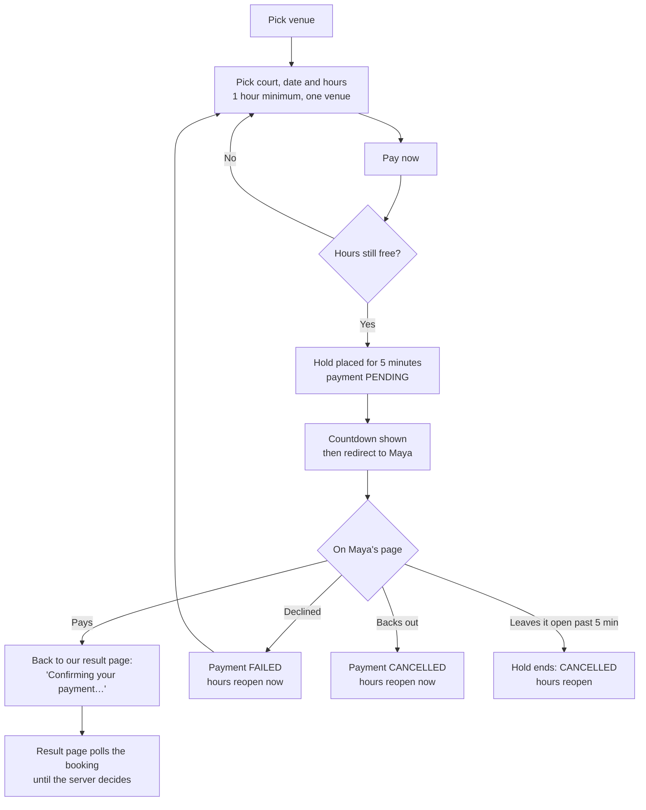
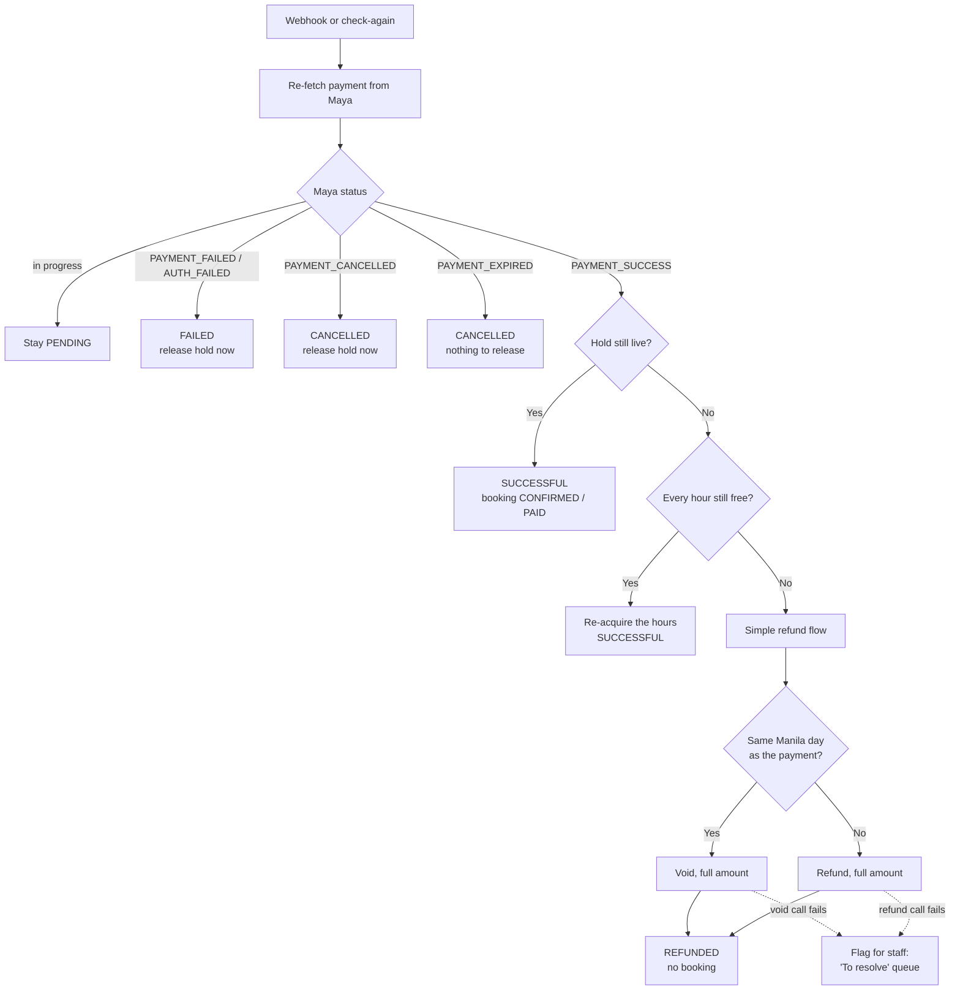
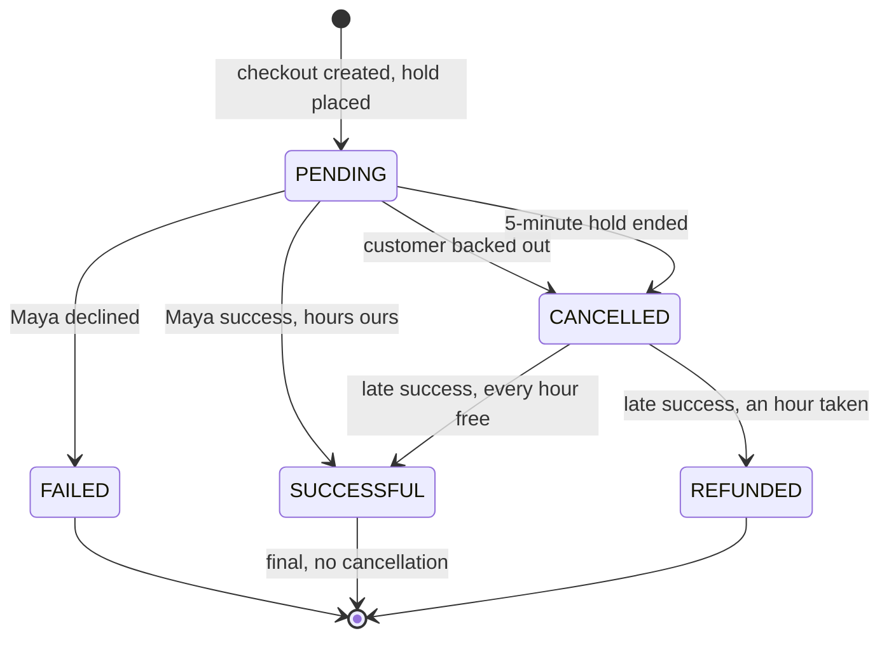

# ADR 0004: Online payment flow and statuses

**Date:** 2026-10-27
**Status:** Accepted — built in
[the customer booking demo](../plans/2026-10-28-customer-booking-demo.md)
**Builds on:** [ADR 0001](0001-booking-slot-uniqueness.md) (one index decides
occupancy), [ADR 0002](0002-maya-payment-provider.md) (Maya Checkout,
unsigned webhooks, one-hour sessions)

## Context

Customers will book and pay online — first on a web test page that stands in
for the mobile app, then in the app itself. Both use the same customer API.
Payment goes through **Maya Checkout**: we create a checkout, send the
customer to Maya's hosted page, and learn the outcome from Maya.

Three facts about Maya shape every decision below (verified 2026-10-27,
sources at the end):

1. **A checkout session lives one hour**, and Maya documents **no way for a
   merchant to close it early.** Only the customer can cancel it ("Back to
   merchant"). Whatever our timers say, a customer holding the link can pay
   for up to an hour.
2. **The redirect back to our site proves nothing.** Only the webhook, and
   then only after we re-fetch the payment from Maya (ADR 0002), is the
   outcome.
3. **A successful payment can be undone two ways:** a **void** on the same
   day (before 12:00 AM GMT+8, full amount only), or a **refund** from the
   next day for up to 180 days. Both must be enabled for the merchant by
   Maya; their API specs are shared only after enablement.

The court slot is the scarce thing. Two customers must never both pay for the
same hour, and a customer must never lose money to an hour they did not get.

## Decisions

| # | Decision | Decided by |
|---|---|---|
| 1 | **No cart.** A customer picks hours and pays immediately. Nothing is saved for later. | Owner |
| 2 | One payment covers **one venue**: any hours on any of its courts, picked together. Another venue is another booking and another payment. | Owner |
| 3 | Starting checkout places a **5-minute hold** (`hold_duration_minutes = 5`). The first customer to *start checkout* gets the hours; anyone after them sees the hours as taken. | Owner |
| 4 | The hold is the **official timer**. When it ends, the attempt is cancelled on our side and the hours reopen at once — even if Maya's page is still open. | Owner |
| 5 | A customer who backs out of Maya (cancel) frees the hours **immediately**. | Owner |
| 6 | **Once paid, a booking is final.** No cancellation, no refund at the customer's request. | Owner |
| 7 | **Simple refund flow:** if Maya reports success after the hold ended *and any* of the hours was taken by someone else, the **whole** payment is voided (same day) or refunded (next day) and **no booking is made**. Exceeding the 5 minutes is the customer's risk. | Owner |
| 8 | If Maya reports success after the hold ended but **every** hour is still free, the hours are booked as normal. | Existing behaviour, kept |
| 9 | Customers see **five** payment statuses (below). Maya's `PAYMENT_EXPIRED` is not one of them: by the time it arrives (minute 60), our hold already cancelled the attempt (minute 5). Maya's exact wording is still stored on the attempt. | My call, agreed |
| 10 | A **failed** payment **releases the hold immediately**. The hours are free for anyone; the customer who failed gets no reserved retry and must start a new booking like everyone else. | Owner |

## Payment statuses

These are the statuses of one **payment attempt** (`payments.status`), and
what the customer sees. One attempt per booking: there is no retry on the
same hold (decision 10).

| Status | Meaning | Final? | Booking (`booking_groups`) |
|---|---|---|---|
| `PENDING` | Checkout created; waiting for Maya | No | `PENDING`, hold live |
| `SUCCESSFUL` | Maya confirmed payment and every hour is ours | Yes | `CONFIRMED` / `PAID` |
| `FAILED` | Maya declined it (funds, fraud check, 3-D Secure failure) | Yes | `CANCELLED`, hold released at once |
| `CANCELLED` | The customer backed out, or our 5-minute hold ended first | Yes | `CANCELLED` (backed out) or `EXPIRED` (hold ended) |
| `REFUNDED` | Maya confirmed payment, but an hour was lost after the hold ended — voided or refunded | Yes | `EXPIRED`, never booked |

Every attempt also stores Maya's own status (`provider_status`, for example
`PAYMENT_EXPIRED`) and, for `REFUNDED`, which action was used (`VOID` or
`REFUND`) and Maya's reference for it.

### Maya status → our status

| Maya says (after re-fetch) | Hold still live? | Our status |
|---|---|---|
| `PENDING_TOKEN`, `PENDING_PAYMENT`, `FOR_AUTHENTICATION`, `AUTHENTICATING`, `AUTH_SUCCESS`, `PAYMENT_PROCESSING` | — | `PENDING` (no change) |
| `PAYMENT_SUCCESS` | Yes | `SUCCESSFUL` |
| `PAYMENT_SUCCESS` | No, all hours free | `SUCCESSFUL` (re-acquired) |
| `PAYMENT_SUCCESS` | No, any hour taken | `REFUNDED` (void or refund) |
| `PAYMENT_FAILED`, `AUTH_FAILED` | — | `FAILED` |
| `PAYMENT_CANCELLED` | — | `CANCELLED` |
| `PAYMENT_EXPIRED` | — | `CANCELLED` (already, since minute 5) |
| `VOIDED`, `REFUNDED` | — | `REFUNDED` (confirms our own action) |
| anything else | — | unchanged; logged and re-checked later |

## The flow

### What the customer does

### What the server decides

The webhook and the result page's "check again" both go through one path:
re-fetch the payment from Maya, record the event once, then apply it.

### Statuses over time

A `CANCELLED` attempt can still turn into `SUCCESSFUL` or `REFUNDED`,
because Maya keeps accepting payment on the link for an hour (Context, 1).
Every other final status stays final.

## Timers

| Timer | Length | Owner | Ends with |
|---|---|---|---|
| Hold | 5 min (parameter) | Us | Hours reopen; attempt `CANCELLED` |
| Maya session | 60 min (fixed) | Maya | `PAYMENT_EXPIRED` webhook; no change for us |
| Void window | Until 12:00 AM GMT+8 that day | Maya | After it, use a refund |
| Refund window | 180 days | Maya | After it, Maya's aftersales team, by hand |

`min_lead_minutes` may be lower than `hold_duration_minutes`, down to 0 (the
owner books 1–2 PM at 12:58 PM), so a hold may run a few minutes into the
hour it holds. An hour whose start has passed can never be held, and a late
payment never re-acquires one (design call 1).

## Test scenarios

Each one runs against the mock provider, which offers every outcome as a
button (pay, decline, back out, let it expire) plus void and refund. The
same scenarios become the sandbox checklist for the real Maya adapter.

| # | Given | When | Then |
|---|---|---|---|
| 1 | A free hour | A customer pays within 5 min | `SUCCESSFUL`; booking `CONFIRMED / PAID` |
| 2 | Two customers want the same hour | Both press "Pay now" | The first gets the hold; the second is told the hour is taken and never reaches Maya |
| 3 | A held hour | The customer backs out on Maya | `CANCELLED`; the hour is bookable again immediately |
| 4 | A held hour | Maya declines the card | `FAILED`; the hour is bookable by anyone immediately |
| 5 | As 4 | The same customer presses "Pay now" again | A **new** booking and hold, only if the hour is still free; no carry-over from the failed one |
| 6 | A held hour | The customer never returns from Maya | At 5 min: `CANCELLED`, hour reopens. At 60 min Maya's expired webhook changes nothing |
| 7 | Hold ended, hour still free | The customer pays at minute 12 | Re-acquired; `SUCCESSFUL` |
| 8 | Hold ended, another customer booked the hour | The first customer pays at minute 12 | Same day → **void**, `REFUNDED`, no booking |
| 9 | As 8, two hours on two courts, only one taken | The customer pays late | **Whole** payment voided; neither hour booked |
| 10 | As 8, but the payment lands after midnight | — | **Refund** instead of void; `REFUNDED` |
| 11 | As 8 | The void call fails | Attempt flagged for staff ("To resolve"); never silently dropped |
| 12 | A confirmed, paid booking | The customer tries to cancel | Refused: paid bookings are final |
| 13 | Any outcome | The same webhook arrives twice | Applied once (event idempotency, ADR 0002) |
| 14 | Any outcome | A webhook body claims success but Maya's re-fetch says pending | Stays `PENDING`: the body is never trusted |
| 15 | A successful payment | The customer lands on the failure redirect URL | Result page shows `SUCCESSFUL`: the redirect is never trusted |
| 16 | Hours at two venues | The customer tries one payment for both | Refused; one venue per payment |
| 17 | A 1-hour session reaching 12 AM | — | Booked and priced on its Manila day (spec §5) |

## Consequences

- `payments.status` gains `SUCCESSFUL` (replacing `PAID`) and `REFUNDED`;
  `EXPIRED` is folded into `CANCELLED`. Each attempt gains
  `provider_status`, and a refund record (`VOID` / `REFUND`, Maya's
  reference, when). Change `docs/adr/pikol.dbml` first, then migrate.
- One payment must be able to cover **several booking groups** (one per
  court, same venue). Today a payment belongs to one group. The design doc
  for the customer booking flow settles the exact shape.
- The provider port gains `void(payment_id)` and `refund(payment_id,
  amount)`. The mock implements both now; the Maya adapter implements them
  once Maya enables the feature for the merchant.
- **Ask Maya early** to enable void and refund for the merchant account, and
  to confirm there is still no merchant-side "cancel checkout" call. Both
  join the business registration on the long-pole list.
- `hold_duration_minutes` changes from 15 to 5 (a parameter edit).
- The "retry checkout on a live hold" customer route
  (`POST /bookings/me/{id}/checkout`) no longer has a use: a failed or
  cancelled attempt has already released its hold. It is removed.

## Sources

- [Understanding payment statuses in Maya Checkout](https://developers.maya.ph/reference/understanding-payment-statuses-in-maya-checkout)
- [Configuring your webhook for Maya Checkout](https://developers.maya.ph/reference/configuring-your-webhook-for-maya-checkout)
- [Accept one-time payment using Maya Checkout](https://developers.maya.ph/reference/accept-one-time-payment-using-maya-checkout)
- [Managing voids and refunds in Maya Checkout](https://developers.maya.ph/reference/managing-voids-and-refunds-in-maya-checkout)
- [Maya forum: handling transaction cancellations](https://dev-forum.maya.ph/t/how-should-i-handle-transaction-cancellations/270)
- [Maya forum: void and refund handling](https://dev-forum.maya.ph/t/how-do-maya-api-handle-void-and-refund/305)
- [Maya developer discussion: cancelling a created checkout](https://developers.maya.ph/discuss/65609564a2217a005d65dcf5)
